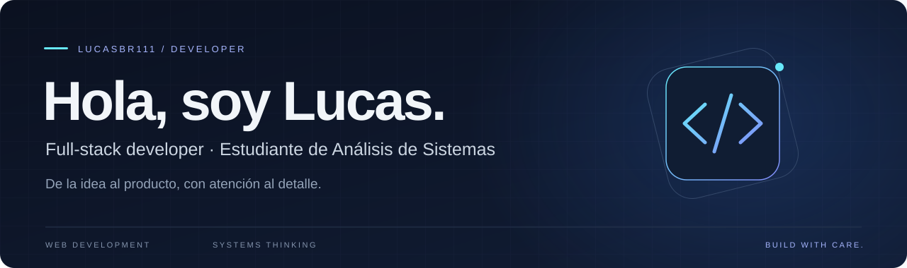

  

  <a href="#sobre-mí">Sobre mí</a> &nbsp;·&nbsp;
  <a href="#tecnologías">Tecnologías</a> &nbsp;·&nbsp;
  <a href="#proyectos-destacados">Proyectos</a> &nbsp;·&nbsp;
  <a href="#conectemos">Contacto</a>

 

## Sobre mí

Soy **Lucas**, desarrollador full-stack y estudiante de **Análisis de Sistemas**. Me interesa transformar necesidades de negocio en aplicaciones web claras, útiles y fáciles de mantener.

Trabajo en interfaces, lógica de negocio y datos, con especial atención a cómo encajan las partes de un producto. En mis proyectos conviven el desarrollo con PHP y la construcción de aplicaciones con TypeScript y Next.js.

- **Lo que construyo:** sitios para negocios, herramientas de gestión y experiencias digitales.
- **Mi enfoque:** entender el problema, cuidar la experiencia y mantener el código organizado.
- **En qué estoy trabajando:** EVOTAP, una propuesta que conecta NFC y QR con experiencias web.

 

## Tecnologías

**Interfaces y aplicaciones web**

  

**Backend, datos y herramientas**

  

Tecnologías presentes en mis proyectos públicos; cada proyecto tiene sus propias decisiones y alcance.

 

## Proyectos destacados

<table>
  <tr>
    <td width="50%" valign="top">
      <h3><a href="https://github.com/LucasBr111/Evotap">EVOTAP ↗</a></h3>
      
Proyecto SaaS para conectar NFC y QR con experiencias digitales configurables para negocios.

      
<code>TypeScript</code> <code>Next.js</code> <code>Prisma</code>

      En desarrollo · Base monorepo y arquitectura del producto.
    </td>
    <td width="50%" valign="top">
      <h3><a href="https://github.com/LucasBr111/eon">Eón Solutions ↗</a></h3>
      
Sitio institucional de un estudio de desarrollo web, con identidad visual oscura y foco en la presentación de servicios.

      
<code>HTML</code> <code>CSS</code> <code>JavaScript</code>

      Diseño web · Identidad visual · Experiencia responsive.
    </td>
  </tr>
  <tr>
    <td width="50%" valign="top">
      <h3><a href="https://github.com/LucasBr111/Biblioteca-FD">Biblioteca FD ↗</a></h3>
      
Plataforma de gestión y distribución de recursos educativos digitales, con categorías, libros y materiales en PDF.

      
<code>PHP</code> <code>MySQL</code> <code>JavaScript</code>

      Aplicación web · Organización de contenido · Datos.
    </td>
    <td width="50%" valign="top">
      <h3><a href="https://github.com/LucasBr111/Portfolio">Portfolio ↗</a></h3>
      
Mi espacio personal para explorar cómo presentar mi trabajo y mi identidad como desarrollador.

      
<code>Frontend</code> <code>Diseño web</code>

      Presentación personal · Exploración visual.
    </td>
  </tr>
</table>

  <a href="https://github.com/LucasBr111?tab=repositories">Explorar todos los repositorios →</a>

 

## Conectemos

¿Tienes una idea, un proyecto o ganas de colaborar? Puedes encontrarme en GitHub y conocer mi trabajo en los repositorios de arriba.

  
  

---

  Ideas claras. Código cuidado. Productos útiles.

